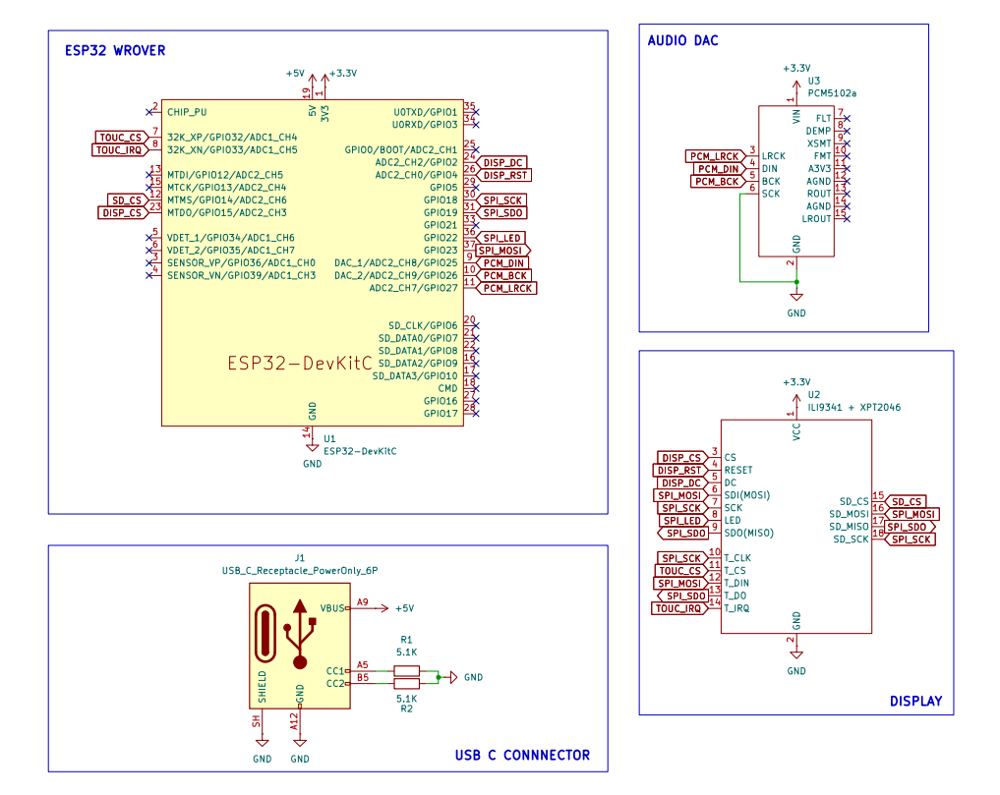
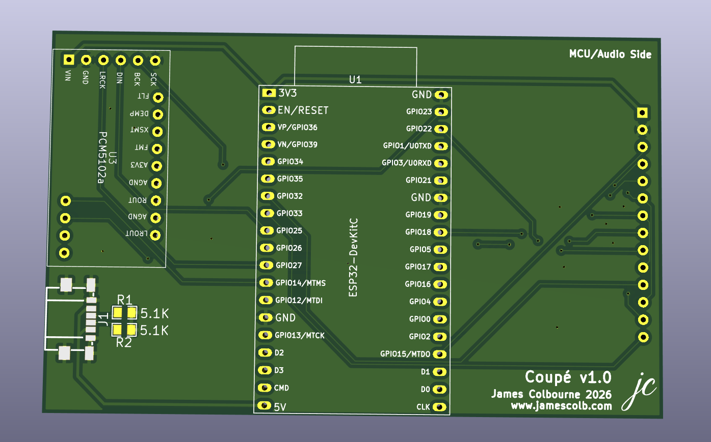

# Coupé

A modern Bluetooth audio system for your vehicle.

## What is it?

The Coupé is a small ESP32 powered drop-in infotainment system for your vehicle. It receives audio over Bluetooth from your mobile device and plays it to your car through an I2S compatible DAC. It also consists of a 3.2 inch touch display that indicates what song is playing, artist, album, along with the cover art.

## Building

These are the steps for building your own Coupé.

### Parts List

Below is a general parts list of what you may need. If you choose to build one without a PCB, you may need wire and a breadboard/perfboard. If you choose to use a PCB, you may want to ensure you have a soldering iron and solder. You may also want to have a 3D printer on hand (the 3D print shown here has been printed on both the Bambu X1E and P2S).

| Part | Role | Description | Vendor |
| --- | --- | --- | --- |
| ESP32 WROVER | MCU | Selected due to built in 4-8 MB of PSRAM, Classic BT | AliExpress
| PCM5102a | DAC | Excellent sound quality and reasonable signal strength w/o amplification | AliExpress
| Generic ILI9341/XPT2046 3.2" TFT Touch Display | Display | Reasonably cost effective, decently large, touch, typically with a red PCB | AliExpress
| Custom PCB (Optional) | PCB | KiCad PCB design provided | JLCPCB (or other)
| 3D Printed Enclosure (Optional) | Case | Fusion 360 .f3d and .3mf provided | PLA/PETG

### Schematic
As a general guide to how everything is going to be connected, below is the schematic. Here, the USB C receptacle is fully optional, as it is only supplying 5V to the AMS1117 on the ESP32 board itself, which could be done with its own UART connector regardless. Making all connections listed in this schematic will allow you to have a working prototype before ordering a custom PCB.

### PCB
Below is the PCB that will be used for the project. Its dimensions are 90 mm x 56 mm, being just larger than the 3.2" display. It is shown below:

Currently, my PCB fab of choice is JLCPCB, as they have been easiest to work with so far. The KiCad project included is also already set for their machine tolerances and has been confirmed to work.

To order a PCB, you will have to manually generate Gerbers and drilling files. A good guide from JLC to do this can be found here:

https://jlcpcb.com/help/article/how-to-generate-gerber-and-drill-files-in-kicad-9

Currently, this board is set up to be 4 layers, however it could be reduced to 2 by removing the two inner layers.

### 3D Printed Enclosure

Readme to be completed...